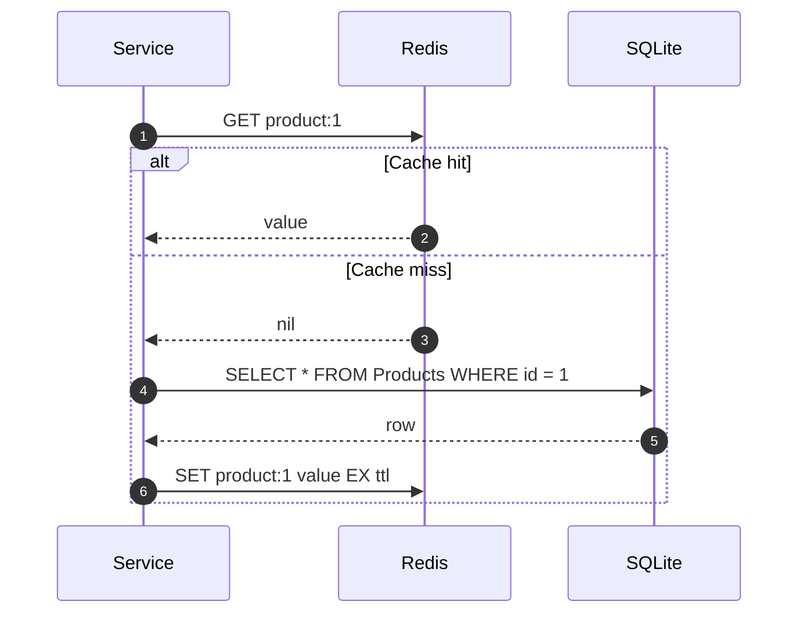
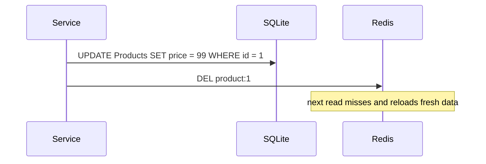
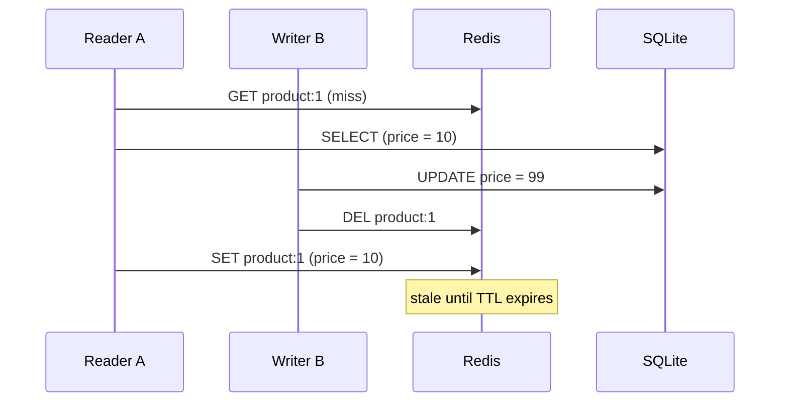
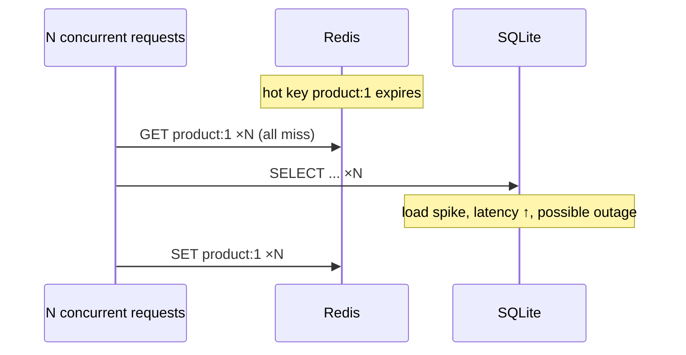
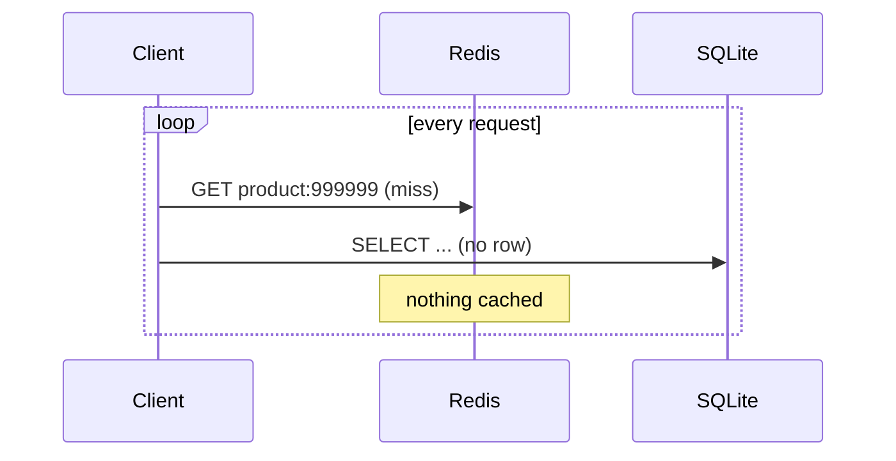
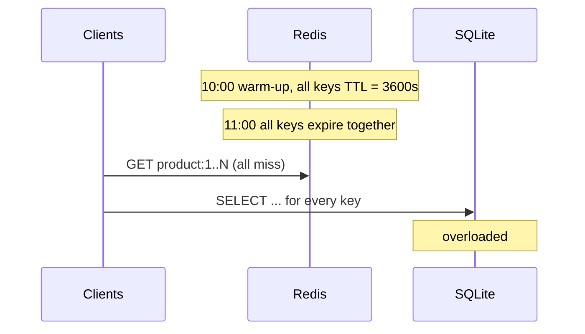

# Cache-Aside (Lazy Loading)

The application owns the cache. On a read it checks Redis first; on a miss it loads from the DB and
puts the result into Redis itself. The cache never talks to the DB — it is "aside" the data path.

## Flow



Writes go to the DB, then the cached key is **invalidated** (deleted), not updated:



## When it is useful

- **Read-heavy, write-light data** — product catalog, user profiles, config, reference data.
- **Only a subset is hot** — only keys that are actually read take up cache memory.
- **Cache failure must not break reads** — if Redis is down the app can still go to the DB.
- **Slightly stale data is acceptable** within the TTL window.
- **Simple to add** to an existing service — no changes to the DB or the cache server.

## When it is a poor fit

- Write-heavy data where every write invalidates and the next read misses (hit ratio collapses).
- Data that must be strongly consistent with the DB (balances, inventory at checkout).
- Latency-critical paths where even the first miss is too slow (consider pre-warming / read-through
  / refresh-ahead).

## Problems and how they occur

### 1. Stale data — read/write race

A reader misses, reads the *old* row, gets delayed, and writes it to cache **after** a writer has
updated the DB and deleted the key. The stale value now lives until TTL expiry.



Also occurs when: the `DEL` after the DB write fails (network error, crash between the two
steps), or the app **updates** the cache instead of deleting it and two writers interleave.

Mitigations to explore: delete instead of update, short TTL as a safety net, delayed double
delete, versioned values / compare-and-set, invalidate from DB change events (CDC).

### 2. Cache stampede (thundering herd / dog-piling)

A hot key expires; hundreds of concurrent requests all miss at the same moment and all hit the
DB with the same query.



Mitigations to explore: mutex/lock (`SET NX`) so one request rebuilds, request coalescing
(single-flight), early probabilistic refresh, serve stale while revalidating.

### 3. Cache penetration

Requests for keys that **don't exist** in the DB (`id = -1`, random IDs, scraping/attacks). The DB
returns nothing, nothing is cached, so every request goes straight to the DB.



Mitigations to explore: cache negative results (short TTL), Bloom filter of valid IDs, input
validation.

### 4. Cache avalanche

Many keys expire **at the same time** (all loaded together with the same TTL, e.g. after a deploy
or warm-up), or Redis itself goes down/restarts. Load on the DB jumps from a trickle to near 100%
of traffic.



Mitigations to explore: TTL jitter (random spread), staggered warm-up, Redis HA, circuit breaker
/ rate limit on DB fallback.

### 5. Hot key

A single key gets a huge share of traffic (flash sale product). Even when cached, one Redis shard
is saturated, and when it expires it triggers a stampede (problem 2).

Mitigations to explore: local in-process cache (L1) in front of Redis, key replication
(`product:1:{0..n}`), never-expire + background refresh.

### 6. Cold start

After a deploy, cache flush, or Redis restart the cache is empty, so the first wave of traffic is
all misses.

Mitigations to explore: pre-warming top-N keys, gradual traffic ramp-up.

### 7. Cache unavailable / slow

If Redis errors or hangs and the code doesn't handle it, a cache outage becomes an app outage, or
every request waits for a Redis timeout before falling back to the DB.

Mitigations to explore: short Redis timeouts, fail-open to DB, circuit breaker around Redis.

## Summary

| Problem         | Trigger                                   | Impact                     |
| --------------- | ----------------------------------------- | -------------------------- |
| Stale data      | Read/write race, failed invalidation      | Wrong data until TTL       |
| Stampede        | Hot key expires under concurrency         | DB spike for one key       |
| Penetration     | Lookups for non-existent keys             | Every request hits DB      |
| Avalanche       | Mass expiry or Redis down                 | DB gets all traffic        |
| Hot key         | Skewed traffic to one key                 | Single Redis shard overload|
| Cold start      | Empty cache after deploy / flush          | Temporary DB spike         |
| Cache down      | Redis error / latency                     | Outage or slow requests    |

## Implementation

[`productService.js`](productService.js) is a deliberately naive cache-aside: `getProduct(id)` and
`updateProduct(id, fields)`, with no protection against any of the problems above. It counts cache
hits, misses and DB reads in `stats`. `getProduct` takes `dbDelayMs` to simulate a slow query so
races and stampedes are visible against a fast local SQLite.

## Scenarios

Each script in [`scenarios/`](scenarios) reproduces one problem against the naive service. Run one:

```sh
node strategies/read/cache-aside/scenarios/03-stampede.js
```

or all of them:

```sh
npm run cache-aside
```

| Script               | Reproduces                                     | What to look for                     |
| -------------------- | ---------------------------------------------- | ------------------------------------ |
| `01-happy-path.js`   | Normal miss-then-hit                           | 1 DB read, rest from cache           |
| `02-stale-data.js`   | Read/write race; lost invalidation             | `STALE`: cache price ≠ DB price      |
| `03-stampede.js`     | 100 concurrent reads on a missing key          | 100 DB reads instead of 1            |
| `04-penetration.js`  | Repeated reads of a non-existent ID            | Every request hits the DB            |
| `05-avalanche.js`    | 100 keys with the same TTL expire together     | 0 DB reads, then 100 at once         |
| `06-hot-key.js`      | 90% of traffic on one key with a short TTL     | ~90 DB reads every time it expires   |
| `07-cold-start.js`   | Traffic on an empty cache                      | DB reads drop batch by batch         |
| `08-cache-down.js`   | Redis paused (`CLIENT PAUSE`), then closed     | 2s request; failed request           |

Each script clears `product:*` keys and resets seed prices first, so runs are repeatable. Once a
mitigation is in place, the same scenario should show the problem gone.

Note: `08-cache-down.js` pauses **all** clients of the local Redis for 2 seconds.
